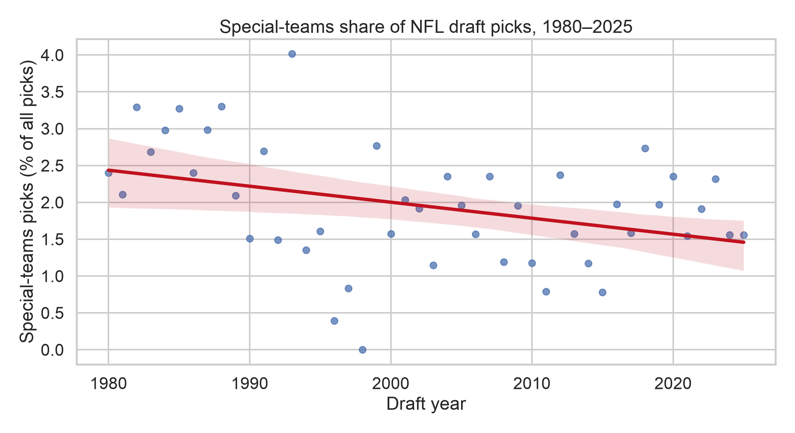
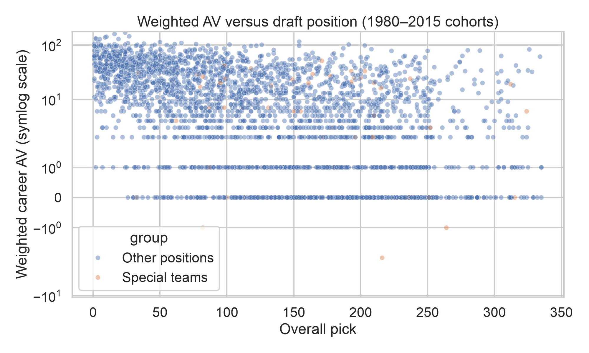

# NFL Special-Teams Draft Value and Realized Career Outcomes

## Research question

> **How has the draft value assigned to NFL special-teams players changed since 1980, and do their subsequent career outcomes indicate favorable realized value relative to their selection position?**

## Executive summary

This study examines how NFL teams have valued special-teams players in the draft and whether drafted specialists subsequently produced favorable career outcomes relative to where they were selected. The analysis uses 12,670 NFL draft selections from 1980–2025, including 253 players classified as special teams. Draft behavior is studied across the full period, while career-outcome comparisons are restricted to the 1980–2015 draft cohorts to reduce bias from incomplete careers.

The share of draft selections allocated to specialists declined from 2.75% in the 1980s to 1.61% in the 2010s, followed by a partial rebound to 1.87% during 2020–2025. A linear annual trend estimates a decline of 0.0217 percentage points per year (p = 0.0148). The decline is statistically detectable but uneven: draft year explains approximately 12.8% of annual variation.

In the mature cohorts, specialists were selected later than other players—their median selection was 189 compared with 140—but they played substantially more career games. Specialists had lower mean weighted Approximate Value (wAV), higher median wAV, and higher raw rates of Pro Bowl and All-Pro recognition. In a robust regression controlling for overall pick and draft decade, special-teams status was positively associated with `log(1 + wAV)` (coefficient = 0.321, p = 0.00275).

The findings are consistent with a selective-investment interpretation: teams draft specialists relatively infrequently and normally at later selections, but the specialists who establish NFL careers often remain in the league for a long time. The results do not demonstrate causation, financial surplus, or superior modern evaluation. Approximate Value is also an incomplete measure of specialist performance.

## 1. Research motivation

NFL draft selections represent scarce capital. A team that uses a pick on a kicker, punter, long snapper, or return specialist gives up the opportunity to select a player at another position. Draft frequency and selection position therefore reveal how teams value specialist prospects before those players enter the league.

The realized value of a draft decision is observed only later through career performance and longevity. This creates two related but distinct concepts:

| Value stage | Meaning | Measures used here |
|---|---|---|
| Draft-assigned value | The value revealed by the team's selection decision | Selection frequency, share of all picks, overall pick |
| Realized career value | Outcomes recorded after the player is drafted | Weighted AV, games, Pro Bowls, All-Pro selections |

The research question asks both whether draft-assigned value changed historically and whether specialists' later outcomes appear favorable after accounting for their selection positions.

## 2. Data selection

### 2.1 Primary data

The main source is the [nflverse Draft Picks dataset](https://github.com/nflverse/nflverse-data/releases/tag/draft_picks), which is based on Pro Football Reference draft records. Relevant fields include:

- Draft season
- Round and overall pick
- Drafting team
- Player and position identifiers
- Position category and side of the ball
- Age
- Games played
- Weighted career Approximate Value
- Pro Bowl selections
- All-Pro selections

The draft data are joined by overall selection number to the [nflverse/nfldata Draft Values table](https://github.com/nflverse/nfldata/blob/master/data/draft_values.csv), which contains the Stuart, Jimmy Johnson, Rich Hill, OTC, and PFF pick-value scales.

### 2.2 Study population

The downloaded source contains selections through the 2026 draft. The 2026 class is excluded because those players do not yet have NFL outcomes. The resulting draft-behavior sample contains:

- 12,670 selections
- Draft years 1980–2025
- 253 special-teams selections
- Special teams account for 2.00% of the complete sample

Career-outcome comparisons end with the 2015 draft. This gives every included cohort at least ten possible NFL seasons before the current data snapshot and reduces right-censoring. The mature-cohort sample contains 10,105 selections: 203 specialists and 9,902 players at other positions.

### 2.3 Special-teams definition

A player is classified as special teams when either:

```text
side == "S"
```

or the player's category is one of:

```text
K, P, LS, KR, ST
```

Across 1980–2025, the specialist group contains:

| Category | Players |
|---|---:|
| Kicker | 123 |
| Punter | 119 |
| Long snapper | 9 |
| Return specialist | 2 |
| **Total** | **253** |

Because kickers and punters account for 242 of the 253 observations, the aggregate findings primarily describe those positions. The data are insufficient for strong position-specific conclusions about long snappers or return specialists.

## 3. Data cleaning and preparation

The reproducible cleaning process is implemented in [`src/analyze.py`](../../src/analyze.py).

### 3.1 Source validation

Before analysis, the pipeline verifies that the draft file contains the required columns:

```text
season, round, pick, team, side, category, position,
w_av, car_av, games, probowls, allpro
```

The tests also verify that:

- Each `(season, pick)` combination is unique
- Draft-value pick numbers are unique
- The draft-value table begins with overall pick 1

### 3.2 Join procedure

Draft selections are joined to the pick-value table using `pick` as a many-to-one key. This is appropriate because each overall pick can appear once per draft year, while each pick number has one row in the generic value table.

### 3.3 Constructed variables

The pipeline creates:

- `is_special_teams`: specialist indicator
- `decade`: numerical decade derived from draft year
- `decade_label`: readable decade category
- `st_category`: specialist category or `Non-ST`
- `outcome_eligible`: indicator for draft seasons through 2015

The cleaned file is stored as [`data/processed/draft_picks_enriched.csv`](../../data/processed/draft_picks_enriched.csv).

### 3.4 Missing data

The current source contains a `car_av` field, but the field is entirely missing. Career AV is therefore excluded rather than interpreted as zero. Weighted AV is retained because it is populated for players with recorded outcomes.

The outcome regression uses 8,176 mature-cohort players with nonmissing weighted AV. This complete-case approach means the regression estimates the relationship among players with reported wAV; it should not be interpreted as a model of every selection's probability of reaching the NFL.

### 3.5 Career censoring

Draft behavior can be measured through 2025 because selection frequency and overall pick are observed immediately. Career value cannot be compared fairly over that full period because recent players have had fewer seasons to accumulate games and AV. For that reason:

| Analysis | Period |
|---|---|
| Draft frequency and selection position | 1980–2025 |
| Career outcomes and regression | 1980–2015 cohorts |

## 4. Exploratory data analysis

### 4.1 Specialist drafting by decade

| Draft period | All picks | ST picks | ST share | Mean ST pick |
|---|---:|---:|---:|---:|
| 1980s | 3,342 | 92 | 2.75% | 201.2 |
| 1990s | 2,684 | 45 | 1.68% | 188.7 |
| 2000s | 2,551 | 46 | 1.80% | 163.8 |
| 2010s | 2,544 | 41 | 1.61% | 182.4 |
| 2020–2025 | 1,549 | 29 | 1.87% | 189.7 |

The strongest historical change is the frequency with which teams use picks on specialists. The mean overall specialist selection does not move consistently in one direction: specialists were selected earliest on average in the 2000s, followed by later averages in the 2010s and partial 2020s.

Mean overall pick must also be interpreted carefully because the number of draft rounds changed historically. Draft share is therefore the cleaner long-run measure of how much selection activity teams allocated to specialists.



### 4.2 Mature-cohort outcomes

| Outcome | Special teams | Other positions |
|---|---:|---:|
| Players | 203 | 9,902 |
| Median overall pick | 189 | 140 |
| Mean weighted AV | 14.6 | 19.6 |
| Median weighted AV | 14 | 9 |
| Mean career games | 114.5 | 70.2 |
| At least one Pro Bowl | 20.7% | 10.6% |
| At least one All-Pro | 12.3% | 4.0% |

Specialists have lower mean wAV but higher median wAV. The non-specialist group contains more extremely high-value players, which raises its mean. Drafted specialists nevertheless display substantially greater average longevity.

The award comparisons are descriptive rather than direct measures of superiority. Pro Bowl and All-Pro opportunities are position-specific, and the number of award slots differs across positions.



## 5. Empirical strategy

The analysis uses two complementary models.

### 5.1 Historical draft-share trend

For each draft year, specialist share is calculated as:

```text
ST share (%) = 100 × special-teams picks / all draft picks
```

The annual trend model is:

```text
STShare_t = β₀ + β₁ Year_t + ε_t
```

The coefficient `β₁` estimates the average annual change in the percentage of draft picks devoted to special teams.

### 5.2 Realized-outcome model

The primary career-outcome specification is:

```text
log(1 + wAVᵢ) = β₀
               + β₁ Pick100ᵢ
               + β₂ SpecialTeamsᵢ
               + Decade fixed effects
               + εᵢ
```

where:

- `wAV` is weighted career Approximate Value
- `Pick100` is overall pick divided by 100
- `SpecialTeams` equals one for specialists
- Decade indicators control for broad differences among the 1980s, 1990s, 2000s, and 2010–2015

The logarithmic transformation reduces the influence of extremely high wAV values and permits inclusion of zero values where observed. Heteroscedasticity-consistent HC3 standard errors are used because career-outcome variance is unlikely to be constant across draft positions.

The model estimates conditional association. It does not establish that drafting a specialist causes higher career value.

## 6. Results

### 6.1 Change in draft-assigned value

The historical trend estimates:

| Statistic | Estimate |
|---|---:|
| Annual change | −0.0217 percentage points |
| p-value | 0.0148 |
| R² | 0.1276 |

Over approximately 45 years, the fitted change is close to a one-percentage-point decline in the share of selections devoted to specialists. The p-value indicates that the fitted downward relationship is statistically distinguishable from zero under the model assumptions. The R² shows that draft year explains only about 12.8% of annual variation, so the historical pattern is neither smooth nor deterministic.

### 6.2 Realized value relative to selection position

The regression contains 8,176 players and has an R² of 0.216.

| Variable | Coefficient | Robust SE | p-value | 95% CI |
|---|---:|---:|---:|---:|
| Special teams | 0.3209 | 0.1072 | 0.00275 | [0.1109, 0.5309] |
| Overall pick ÷ 100 | −0.8072 | 0.0170 | <0.001 | [−0.8406, −0.7738] |

Later selection is strongly associated with lower realized wAV. Conditional on overall pick and draft decade, special-teams status is positively associated with transformed weighted AV.

Exponentiating the specialist coefficient gives:

```text
exp(0.3209) − 1 ≈ 37.8%
```

Accordingly, the model associates specialist status with approximately 37.8% higher `1 + wAV`, holding pick and decade constant. This transformation should be described precisely; it is not equivalent to claiming that specialists produce 37.8% more raw career value or financial return.

The decade coefficients are small and individually statistically insignificant after controlling for pick and specialist status. The model therefore does not show a general increase in wAV for all drafted players across these broad decades.

## 7. Interpretation

The combined evidence supports four conclusions:

1. **Specialists receive a smaller share of NFL draft selections than in the 1980s.** The decline is modest but statistically detectable.
2. **Specialists are usually selected later than players at other positions.** Their median mature-cohort selection is pick 189.
3. **Drafted specialists show substantial career longevity.** They averaged approximately 114.5 games in the mature sample.
4. **Their pick-adjusted wAV association is favorable.** Specialists have higher transformed wAV after controlling for selection position and decade.

These results are consistent with teams using draft selections on specialists selectively. A team may avoid drafting a kicker or punter unless it believes the player has a strong probability of winning and retaining an NFL job. That selection process can produce a small drafted population with relatively durable careers.

The study does not establish that specialists are categorically more valuable than offensive or defensive players. Positional labor markets, award structures, career lengths, and the construction of AV differ substantially.

## 8. Limitations

### Measurement of specialist value

Weighted AV is useful for broad comparison but does not fully measure:

- Field-goal difficulty or accuracy above expectation
- Kickoff value
- Punt hang time
- Net field-position value
- Return suppression
- Long-snapping quality
- High-leverage performance

### Missing outcomes

The source's `car_av` field is entirely missing. The regression also uses only observations with reported wAV. These limitations should be disclosed in any academic presentation.

### Historical comparability

Draft length, roster rules, schedule length, specialist usage, and league strategy changed during the study period. Decade controls absorb only broad differences.

### Selection and causality

Teams choose which specialists to draft. Drafted specialists may differ from other players in unobserved quality, positional competition, organizational patience, and probability of immediate opportunity. The coefficient on specialist status is therefore associational.

### Financial value

The analysis measures performance relative to selection position, not dollar surplus. A complete financial-value study would require rookie compensation, cap charges, draft-day trade costs, and the performance of alternative players available at the same pick.

## 9. Conclusion

NFL teams have reduced the share of draft selections allocated to special-teams players since 1980, although the decline is uneven and the partial 2020s show some recovery. Specialists are generally selected later than other players, but mature drafted specialists exhibit substantial career longevity and favorable transformed weighted AV after controlling for overall selection and draft decade.

The most defensible conclusion is that NFL teams use draft picks on specialists selectively and that the specialists who are drafted often provide durable realized performance relative to their selection positions. The evidence does not establish causal evaluation skill or financial surplus, and specialist-specific performance metrics are needed to determine whether the observed durability translates into superior on-field or economic value.

## 10. Reproduction

From the project root:

```bash
source .venv/bin/activate
pip install -r requirements.txt
python src/analyze.py
pytest -q
```

Generated outputs are stored in:

```text
analyses/01_special_teams_value_over_time/
├── figures/
│   ├── special_teams_pick_by_decade.png
│   ├── special_teams_share_over_time.png
│   └── weighted_av_vs_pick.png
└── tables/
    ├── decade_special_teams_drafting.csv
    ├── key_results.json
    ├── model_summary.txt
    ├── outcomes_through_2015_cohorts.csv
    ├── regression_log_weighted_av.csv
    └── yearly_special_teams_drafting.csv
```

## 11. Related supporting analyses

The broader project contains supporting questions on:

- [Early versus late specialist selections](../02_early_vs_late_selections/)
- [Draft-capital efficiency](../03_draft_capital_efficiency/)
- [Efficiency over time](../04_efficiency_over_time/)
- [Alternative definitions of success](../05_success_definitions/)
- [Drafted versus undrafted specialists](../06_drafted_vs_undrafted/)

These analyses extend the primary question but should be presented as supporting evidence rather than separate primary research projects.
